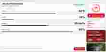

# 🔥 Forest Fire Prediction & Early Warning System

An end-to-end wildfire-risk monitoring platform that combines **machine learning, live environmental data, satellite fire detections, and an interactive web dashboard** to estimate wildfire risk and surface potential fire activity.

> **Important:** This is an engineering/academic early-warning prototype. Its predictions and risk scores are **not official emergency warnings** and must not be used as the sole basis for evacuation or emergency decisions.

[](https://github.com/017Mehul/Forest-Fire-Prediction-and-Early-Warning-System/actions)
[](https://react.dev/)
[](https://fastapi.tiangolo.com/)
[](https://xgboost.readthedocs.io/)

**Live demo:** https://forest-fire-prediction-psi.vercel.app

## 🖥️ Product Preview

### Environmental Intelligence Dashboard


### Wildfire Risk Prediction



The prediction panel demonstrates the risk-scoring workflow using temperature, humidity, wind speed, and vegetation density.

---

## Overview

Wildfire monitoring requires more than a single classification model. This project combines:

- **Calibrated XGBoost** for wildfire-occurrence prediction
- **Environmental risk rules** for interpretable risk signals
- **Open-Meteo** for live weather conditions
- **NASA FIRMS VIIRS NOAA-21** satellite detections for observed fire activity
- **FastAPI** for the prediction and data APIs
- **React + Vite** for an interactive monitoring dashboard
- **Leaflet-based maps** for geographic visualization
- **Automated testing and dependency auditing** through GitHub Actions

The system is designed as a practical demonstration of how an ML model can be connected to real-world data sources and exposed through a deployable full-stack application.

---

## ✨ Key Features

### 🧠 Machine Learning
- Calibrated **XGBoost classifier**
- Explicit model feature contract
- Deployment-time feature metadata validation
- Environmental risk rules alongside model predictions
- Physical-range validation for prediction inputs

### 🌦️ Live Environmental Data
- Current weather from **Open-Meteo**
- Validated WGS84 latitude/longitude inputs
- Weather-enriched prediction endpoint
- Provider timestamps, units, and source metadata in responses

### 🛰️ Satellite Fire Detection
- NASA FIRMS **VIIRS NOAA-21** near-real-time detections
- Server-side FIRMS API key handling
- Geographic bounding-box queries
- No fabricated fire coordinates when live data is unavailable

### 🗺️ Monitoring Dashboard
- Prediction interface
- Interactive map and fire visualization
- Alert/risk views
- Current weather information
- Clear distinction between **predictions, baseline data, and observed satellite detections**

### ⚙️ Backend & Deployment
- FastAPI REST API
- Health endpoint for deployment monitoring
- Strict request validation with Pydantic
- Production-ready Vite build
- Configurable CORS
- Security headers and restrictive browser CSP
- API rate limiting
- CI for backend tests and frontend builds
- Python and npm dependency auditing

---

## 🏗️ Architecture

```
                    ┌─────────────────────┐
                    │   React + Vite UI   │
                    │ Dashboard / Maps    │
                    └──────────┬──────────┘
                               │
                               ▼
                    ┌─────────────────────┐
                    │      FastAPI        │
                    │   REST API Layer    │
                    └──────────┬──────────┘
                               │
          ┌────────────────────┼────────────────────┐
          │                    │                    │
          ▼                    ▼                    ▼
   ┌─────────────┐     ┌─────────────┐     ┌─────────────┐
   │  Prediction │     │ Live Weather│     │ NASA FIRMS  │
   │   Service   │     │ Open-Meteo  │     │  Satellite  │
   └──────┬──────┘     └─────────────┘     └─────────────┘
          │
          ▼
   ┌─────────────────────────────┐
   │ Calibrated XGBoost Model    │
   │ + Environmental Risk Rules  │
   └─────────────────────────────┘
```

---

## 🤖 Machine Learning

The deployed model was trained using ten environmental features:

| # | Feature |
|---|---|
| 1 | `temperature_2m` |
| 2 | `relative_humidity_2m` |
| 3 | `precipitation` |
| 4 | `surface_pressure` |
| 5 | `cloud_cover` |
| 6 | `wind_speed_10m` |
| 7 | `soil_temperature_0_to_7cm` |
| 8 | `soil_temperature_7_to_28cm` |
| 9 | `soil_moisture_0_to_7cm` |
| 10 | `soil_moisture_7_to_28cm` |

### Prediction modes

**Standard prediction — `POST /predict`**

The public UI accepts four environmental inputs:

```json
{
  "temperature": 35,
  "humidity": 20,
  "wind": 30,
  "vegetation": 80
}
```

Because these inputs do not cover all ten training features, the API identifies the result as using **partial environmental inputs**. The backend combines the classifier output with environmental rules. The returned 0–100 value is an engineering **risk score**, not a calibrated probability of ignition.

**Live-weather prediction — `GET /predict/current`**

```
/predict/current?latitude=37.5&longitude=-119.5&vegetation=60
```

This endpoint retrieves current Open-Meteo conditions and supplies six live weather features to the model. Soil temperature and soil moisture remain explicit engineering proxies, and the response is labeled accordingly.

---

## 🔌 API

| Endpoint | Method | Purpose |
|---|---|---|
| `/health` | GET | Service health and version |
| `/predict` | POST | Wildfire-risk prediction |
| `/predict/current` | GET | Prediction using live weather |
| `/weather` | GET | Current Open-Meteo weather |
| `/fires` | GET | NASA FIRMS satellite detections |
| `/heatmap` | GET | Image-derived hotspot coordinates |
| `/zones` | GET | Baseline monitoring zones |

### NASA FIRMS

Set `FIRMS_MAP_KEY` as a **server-side environment variable** to enable live satellite detections.

Request a key from [NASA FIRMS](https://firms.modaps.eosdis.nasa.gov/api/map_key/).

If the key is unavailable, the API returns an error instead of generating fake detections.

### Open-Meteo

Weather data is retrieved from [Open-Meteo](https://open-meteo.com/) and is returned with source metadata and timestamps. The data is licensed under **CC BY 4.0**.

---

## 🧪 Testing

### Backend

```bash
cd backend
pytest -q
```

### Frontend

```bash
cd frontend
npm ci
npm run build
```

GitHub Actions runs backend tests and frontend builds automatically for pushes and pull requests targeting `main`.

Dependency audits are also included in CI, with Dependabot configured for recurring dependency updates.

---

## 🚀 Local Development

### 1. Clone

```bash
git clone https://github.com/017Mehul/Forest-Fire-Prediction-and-Early-Warning-System.git
cd Forest-Fire-Prediction-and-Early-Warning-System
```

### 2. Start the backend

```bash
cd backend
python -m venv .venv
```

**Windows:**

```bash
.venv\\Scripts\\activate
```

**macOS/Linux:**

```bash
source .venv/bin/activate
```

Install dependencies:

```bash
pip install -r requirements.txt
```

For local frontend access:

```bash
export ALLOWED_ORIGINS=http://localhost:5173,http://127.0.0.1:5173
```

Start FastAPI:

```bash
uvicorn main:app --reload
```

### 3. Start the frontend

In a second terminal:

```bash
cd frontend
npm ci
npm run dev
```

Set `VITE_API_URL` to the backend base URL (for example, the deployed Render service URL) before building/deploying the frontend. In Vercel, configure `VITE_API_URL` for the Production and Preview environments and redeploy after changes. Production builds no longer fall back to the visitor’s own `127.0.0.1`.

---

## 🏋️ Model Training

The training script is `XGBoost_Model.py`. It sorts rows chronologically and evaluates on the latest 20% of records rather than randomly mixing future and past observations. It writes `training_metrics.json` with accuracy, ROC-AUC, average-precision PR-AUC, precision, recall, F1, confusion matrix, and the train/test date boundary. These are offline evaluation metrics, not a guarantee of live performance.

Run it from the repository root after installing the backend requirements and providing the dataset at `final-datasets/Trihourly_Weather_Dataset.csv`:

```bash
python XGBoost_Model.py
```

Training produces the model and feature metadata used by the deployment:

```
wildfire_model.pkl
model_features.pkl
backend/model/fire_model.pkl
backend/model/features.json
```

Keeping the deployment artifact and feature metadata aligned helps prevent training/inference feature mismatches.

---

## 🔐 Security & Engineering

Security is treated as part of the application's engineering layer rather than the primary purpose of the project.

Implemented controls include:

- Strict CORS allowlist
- Pydantic input/range validation
- Rejection of unexpected JSON fields
- API rate limiting
- Security response headers
- Restrictive browser CSP
- Server-side handling of provider credentials
- No credentials committed to the repository
- Production source maps disabled
- Sanitized API errors
- Dependency auditing in CI
- Weekly Dependabot updates
- Fixed upstream provider URLs to avoid user-controlled URL fetching

For multi-instance production deployments, the API can use Redis-backed shared rate limiting through `REDIS_URL`. Local/single-instance deployments use a bounded in-memory limiter.

The application currently has **no authentication, user accounts, database, file-upload workflow, or webhook receiver**, so controls such as password hashing, MFA, JWT/session hardening, IDOR protection, database RLS, upload scanning, and webhook signature verification are intentionally not represented as implemented features.

---

## 📊 Data Sources

| Source | Usage |
|---|---|
| Historical weather & wildfire datasets | Model development |
| [Open-Meteo](https://open-meteo.com/) | Live weather |
| [NASA FIRMS](https://firms.modaps.eosdis.nasa.gov/) | Satellite fire detections |
| Bundled baseline zones | Demonstration/monitoring regions |

### Important data distinction

The dashboard intentionally distinguishes between:

- **Model predictions** — estimated wildfire risk
- **Live weather** — current environmental observations from Open-Meteo
- **Satellite detections** — observed FIRMS detections that may include false positives
- **Baseline zones** — bundled demonstration data, not live observations

This prevents static or unavailable data from being presented as real-time wildfire activity.

---

## ⚠️ Limitations

This project is a research/engineering prototype, not an operational wildfire-warning system.

- The standard prediction UI does not directly expose all ten model features; missing weather/soil features are approximated by the backend.\n- The existing bundled model artifact has not been retrained as part of these UI/code corrections. Re-run the training script on the source dataset to generate updated temporal-holdout evaluation metrics.
- Live-weather prediction uses six live weather features; soil variables remain proxies.
- Satellite detections are not confirmed fire incidents or official emergency alerts.
- The image-based heatmap is a computer-vision demonstration and is not a substitute for georeferenced operational fire-detection products.
- Baseline monitoring zones are not live observations.
- Alerts are currently UI/in-memory state rather than persisted notification history.
- No emergency or evacuation decision should rely solely on this application.

---

## 🗺️ Roadmap

Potential future improvements:

- Add richer geospatial fire-risk modeling
- Incorporate live soil-moisture and soil-temperature observations
- Evaluate additional models and calibration methods
- Add historical risk/incident analytics
- Persist alert history
- Add notification delivery for configured users
- Improve geographic coverage and operational data validation
- Add model monitoring and drift detection

---

## 👨‍💻 Author

**Mehul Gupta**  
B.Tech Computer Science & Engineering — Manipal University Jaipur

---

## 📄 License

No open-source license is currently specified for this repository. Add a license before distributing the code as a reusable open-source package.
